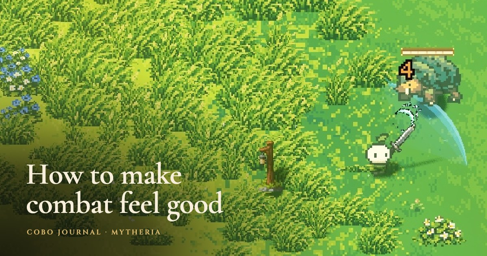
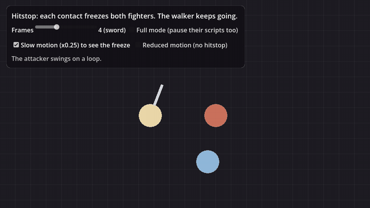

# Hitstop for Godot 4



Hitstop (also hit stop or hit pause) is a freeze of a few frames on the frame a hit connects. Both fighters hold their pose, and the blow feels like it bit into something instead of sliding off. This add-on freezes exactly the fighters you name, for a number of 60 Hz frames, while the rest of the world keeps running.

It's the hitstop from [Mytheria](https://cobomakesgames.com/mytheria/), our pixel-art co-op game. How it fits with the flash, the knockback and the shake, frame by frame, is in [how to make combat feel good](https://cobomakesgames.com/blog/how-to-make-combat-feel-good/).



## Why not Engine.time_scale = 0?

The quick way to do hitstop is to stop the whole game for a moment. That freezes everything: particles, UI animation, the music's visualiser and, in an online game, every other player's view of the world. Mytheria's hitstop never pauses the game. Only the two fighters hold, so nobody else's game stops while you land a combo. This add-on does the same:

- Pose mode, the default, pauses only animation on the fighters: AnimationPlayer, AnimationTree, AnimatedSprite2D/3D and particles. Movement and logic carry on, which keeps co-op in sync.
- Full mode pauses the fighters' whole subtree, scripts included, for single-player games where they should stop completely.
- `freeze_everything()` is there for single-player games that want the classic effect, and gives the time scale back exactly.

The details that bite you in a hand-rolled version are handled:

- Durations are in 60 Hz frames, so `4` means 67 ms at any frame rate.
- Freezes run on game time, so slow motion slows them too.
- A second hit during a freeze extends it to whichever ends later.
- Every value is put back as it was: each speed scale, process mode and AnimationTree state.
- AnimationPlayers are paused and resumed. At speed zero Godot fires a method-track key on the frozen frame again, so an animation that calls your hit code would freeze itself forever.
- A fighter freed mid-freeze is dropped quietly.
- Reduced motion skips every freeze, and `max_frames` caps how long any freeze can get.

## Install

Copy `addons/hitstop` into your project's `addons` folder and enable **Hitstop** under Project Settings > Plugins. Enabling it adds an autoload named `Hitstop`. Godot 4.3 and later (tested on 4.6 and 4.7).

## Use

```gdscript
func _on_sword_hit(attacker: Node, target: Node) -> void:
	Hitstop.freeze([attacker, target], 4)        # a sword hit: 4 frames, about 67 ms
	$Camera2D/ScreenShake.add(3.2, hit_direction, Hitstop.seconds_for(4))
```

What Mytheria uses:

| Hit | Frames |
|---|---|
| Sword | 4 |
| Heavy weapon | 5 |
| Harpoon thrust | 3 |
| Ranged | 1 |
| A kill | a few more |

Start smaller than you think: a long freeze reads as lag, and a fast fight has dozens of hits a minute.

Settings on the autoload: `reduced_motion`, `duration_scale` (a hit pause slider, 0 turns it off) and `max_frames` (12). `freeze(nodes, frames, Hitstop.Mode.FULL)` picks full mode, `is_frozen(node)` and `seconds_for(frames)` answer questions, `release_all()` ends everything, and the `freeze_started` and `freeze_ended` signals fire per node. Set `drive_manually` and call `advance(delta)` to run it on your own clock (replays, lockstep games, tests).

Pairs with [Screen Shake](https://github.com/Cobo-Makes-Games/godot-screen-shake): pass `Hitstop.seconds_for(frames)` as the shake's hold and the camera jolts inside the freeze, so your eyes keep track of the fight.

## Demo and tests

Run the project in this repository: the attacker swings on a loop and every contact freezes both fighters while the walker keeps going. Try slow motion, different frame counts and full mode. The checks run with:

```
godot --headless --path . --script tests/test_hitstop.gd
```

## License

MIT, by [Cobo Makes Games](https://cobomakesgames.com). If it helps your game, we'd love to hear about it.
